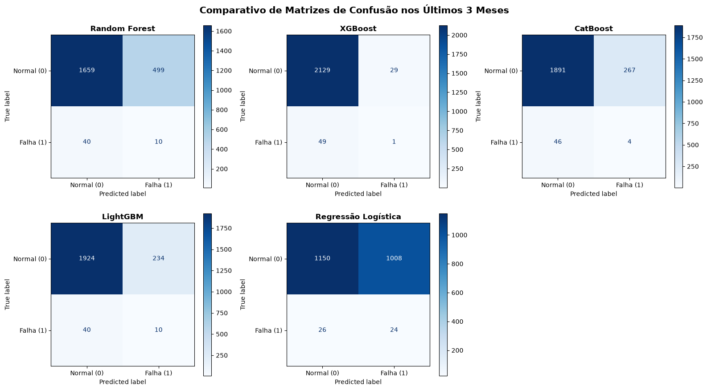

# Projeto de Manutenção Preditiva — Comparativo de Modelos de Machine Learning

## Sobre o projeto

Este projeto tem como objetivo demonstrar a aplicação de técnicas de Machine Learning na manutenção preditiva, utilizando dados sintéticos de sensores de uma máquina para identificar possíveis falhas operacionais.

O projeto gera uma base de telemetria de um ano, realiza engenharia de atributos (*Feature Engineering*), treina cinco modelos de classificação e compara seus resultados por meio de métricas de desempenho e matrizes de confusão.

## Tecnologias utilizadas

- Python
- NumPy
- Pandas
- Matplotlib
- Scikit-learn
- XGBoost
- CatBoost
- LightGBM

## Modelos de Machine Learning

O projeto compara os seguintes algoritmos:

1. Random Forest
2. XGBoost
3. CatBoost
4. LightGBM
5. Regressão Logística

Os modelos são avaliados com as seguintes métricas:

- **Recall (sensibilidade):** proporção de falhas reais identificadas.
- **Precisão:** proporção dos alarmes de falha que correspondem a falhas reais.
- **F1-Score:** equilíbrio entre precisão e recall.
- **Acurácia:** proporção total de previsões corretas.
- **Falsos positivos (FP):** alarmes de falha sem falha real.
- **Falsos negativos (FN):** falhas reais que não foram identificadas.
- **Verdadeiros positivos (TP):** falhas reais identificadas corretamente.

## Estrutura do projeto

```text
PROJETO_MANUTENCAO_PREDITIVA/
├── app_manutencao.py
├── requirements.txt
├── README.md
├── .gitignore
└── matriz_comparativa_5_modelos.png
```

Os arquivos CSV são gerados durante a execução e não precisam estar previamente na pasta.

## Como executar o projeto

### 1. Pré-requisitos

Instale o [Python](https://www.python.org/downloads/) e o [Visual Studio Code](https://code.visualstudio.com/).

No Windows, verifique se o Python está disponível no terminal:

```powershell
python --version
```

### 2. Clone o repositório

Após publicar o projeto no GitHub, copie a URL do repositório e execute:

```powershell
git clone URL_DO_SEU_REPOSITORIO
cd PROJETO_MANUTENCAO_PREDITIVA
```

Substitua `URL_DO_SEU_REPOSITORIO` pela URL real do repositório.

Se você já possui a pasta do projeto no computador, abra-a diretamente no VS Code e pule esta etapa.

### 3. Crie um ambiente virtual

No terminal do VS Code, execute:

```powershell
python -m venv venv
```

Ative o ambiente virtual no Windows:

```powershell
.\venv\Scripts\Activate.ps1
```

Se o PowerShell bloquear a ativação, você pode utilizar o Prompt de Comando (CMD):

```bat
venv\Scripts\activate.bat
```

### 4. Instale as dependências

Com o ambiente virtual ativado, execute:

```powershell
python -m pip install --upgrade pip
pip install -r requirements.txt
```

### 5. Execute a aplicação

Na raiz do projeto, execute:

```powershell
python app_manutencao.py
```

O programa realizará as seguintes etapas:

1. Geração dos dados sintéticos de telemetria.
2. Engenharia de atributos utilizando médias móveis, desvios-padrão e diferenças de temperatura.
3. Divisão temporal entre treino e teste.
4. Treinamento dos cinco modelos de classificação.
5. Cálculo e exibição das métricas de avaliação.
6. Geração e salvamento do painel comparativo de matrizes de confusão.

## Arquivos gerados

Ao executar o programa, serão criados os seguintes arquivos na pasta de execução:

| Arquivo | Descrição |
|---|---|
| `telemetria_maquina_2025.csv` | Base sintética de telemetria de 2025, com sensores e indicação de falhas. |
| `dados_teste_ultimos_3_meses.csv` | Dados separados para avaliação no período de outubro a dezembro de 2025, após a engenharia de atributos e remoção de valores ausentes. |
| `matriz_comparativa_5_modelos.png` | Painel gráfico com as matrizes de confusão dos cinco modelos. |

A imagem é salva no diretório de execução e também exibida pelo Matplotlib. O ambiente gráfico pode variar conforme a configuração do computador.

## Resultado visual



## Metodologia

Os dados são gerados artificialmente a partir de distribuições aleatórias para as variáveis de temperatura, vibração e pressão. A variável-alvo `falha` é definida por regras operacionais e pela inclusão de ruído aleatório.

A engenharia de atributos calcula médias móveis de seis horas, desvios-padrão de janelas de 24 horas e variações de temperatura. Em seguida, os dados são divididos cronologicamente: o período anterior a outubro de 2025 é utilizado para treinamento, e o período a partir de outubro é utilizado para teste.

A Regressão Logística utiliza padronização dos atributos. Os demais modelos são treinados com os atributos sem essa padronização.

## Observações

- Os dados utilizados são sintéticos e não representam medições reais de uma máquina industrial.
- As métricas dependem das regras utilizadas para gerar os dados e não comprovam, por si só, a eficácia em um ambiente industrial real.
- A execução pode levar algum tempo, pois são treinados cinco modelos diferentes.
- Os arquivos CSV são resultados gerados pelo programa e podem ser recriados ao executar o código novamente.

## Autor

Matheus Silva da Cruz

Projeto acadêmico de Ciência de Dados e Inteligência Artificial.
